# ResilioX
### Enterprise Operational Resilience & Business Continuity Intelligence

ResilioX is a multi-tenant resilience workspace that connects business services, impact assessments, technology dependencies, operational risks, controls and continuity plans. It is designed to help teams answer four operational questions:

1. **What matters most?** Identify critical services, processes and supporting assets.
2. **What can disrupt it?** Trace dependencies and assess inherent and residual risk.
3. **How will we respond?** Maintain approved recovery strategies, procedures and communications.
4. **Can we prove readiness?** Schedule exercises, record outcomes and close accountable remediation actions.

> **Project status (22 November 2026):** Milestones 01–08 are merged to `main`; Milestone 09 incident command and response workflows are merged to `main` in PR #12. Milestones 10–13 (PRs #22–#25) are tracked on feature branches and remain unmerged. No production deployment is claimed. Capabilities described as planned are not yet implemented. Seeded records are fictional demo data, not live telemetry.

---

## Contents

- [Product vision](#product-vision)
- [Why this project is different](#why-this-project-is-different)
- [Capabilities](#capabilities)
- [Dashboard showcase — 12 views](#dashboard-showcase--12-views)
- [Enterprise relevance and framework alignment](#enterprise-relevance-and-framework-alignment)
- [Architecture](#architecture)
- [Technology stack](#technology-stack)
- [Security and enterprise controls](#security-and-enterprise-controls)
- [Domain model and business rules](#domain-model-and-business-rules)
- [API surface](#api-surface)
- [Repository structure](#repository-structure)
- [Run locally](#run-locally)
- [Demo workspace and screenshot capture](#demo-workspace-and-screenshot-capture)
- [Quality engineering](#quality-engineering)
- [Roadmap](#roadmap)
- [Known boundaries](#known-boundaries)
- [Contributing](#contributing)
- [License](#license)

## Product vision

Resilience information is frequently split across spreadsheets, document libraries, supplier questionnaires, risk tools and incident systems. That fragmentation makes it hard to connect a business service to its recovery objectives, supporting technology, accountable owners and tested continuity arrangements.

ResilioX brings those records into a shared service-centric model. It emphasizes traceable ownership, explainable scoring, controlled lifecycle transitions and evidence-backed assurance rather than presenting a collection of disconnected dashboards.

### Intended users

- **Chief operating / resilience officers:** portfolio-level exposure and readiness.
- **Business continuity managers:** plans, recovery objectives, exercises and remediation.
- **Service owners:** service criticality, dependencies, recovery responsibilities.
- **Technology and security teams:** technology dependencies, control effectiveness and recovery procedures.
- **Risk and assurance teams:** risk decisions, approvals, evidence and audit history.

## Why this project is different

- **Service-centric resilience:** BIA, dependencies, risks and continuity plans connect to the same business-service context.
- **Evidence before assurance:** only controls recorded as tested can reduce residual risk; exercise outcomes require findings.
- **Governed lifecycle:** plans move through draft, review and authorized approval; exercises have explicit status and result.
- **Tenant-aware by design:** authenticated organization context scopes reads and writes.
- **Explainable models:** scoring formulas, thresholds and assumptions are documented instead of hidden behind an opaque score.
- **Honest data provenance:** demo data is fictional; simulations and integrations are not represented as live feeds.
- **Pragmatic architecture:** a modular monolith keeps transactional workflows cohesive while preserving clear domain boundaries.

## Capabilities

| Domain | Implemented capability | Status |
| --- | --- | --- |
| Identity & tenancy | Password hashing, access tokens, rotating refresh sessions, tenant membership and RBAC | Implemented |
| Executive command center | Tenant overview, service KPIs, criticality distribution, inventory and activity | Implemented |
| Business impact analysis | Versioned assessments, impact horizons, MTPD/RTO/RPO validation, review and approval | Implemented |
| Dependency intelligence | Typed tenant-scoped edges, lifecycle, cycle prevention and verified graph traversal | Implemented |
| Operational risk | Risk register, inherent/residual scoring, service/dependency links and treatment actions | Implemented |
| Control assurance | Control library, evidence-backed test status and residual-risk recalculation | Implemented |
| Business continuity | Service-linked versioned plans, activation criteria, recovery procedures, approval, exercises and remediation | Merged to `main` in PR #11; CI passed |
| Incident & crisis management | Tenant-scoped incident register, SEV-1–SEV-4 classification, guarded lifecycle, commander ownership, timeline, response tasks and audit events | Merged in PR #12; API quality gates passed |
| Disaster recovery | Orchestrated runbooks and gated execution | Planned |
| Third-party resilience | Supplier assessments and concentration analytics | Planned |
| Scenario simulation | Tenant-scoped deterministic impact propagation, service prioritization, assumptions and point-in-time run history | Implemented on feature branch; draft PR #24 |
| Governance & audit | Tenant-scoped evidence register, independent review, policy/control mapping and append-only audit history | Implemented on feature branch; draft PR #25 |
| Notifications & collaboration | Delivery preferences and real-time collaboration | Planned |

## Dashboard showcase — 12 views

The gallery is a single-column sequence of twelve **illustrative SVG UI concepts**, not screenshots of a deployed application. Every metric, name and record shown is fictional sample content and each panel is labeled **ILLUSTRATIVE • NOT LIVE DATA**. These visuals communicate intended product workflows; they are not evidence that a screen, integration or feature is live. Edit the SVG files in `docs/screenshots/` to revise the concepts.

### 1. Executive command center

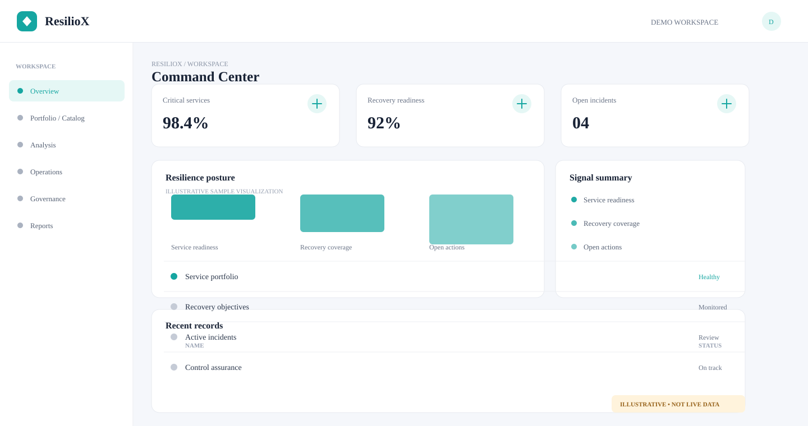

Executive command center — portfolio KPIs, critical services and recent activity.

### 2. Business service portfolio

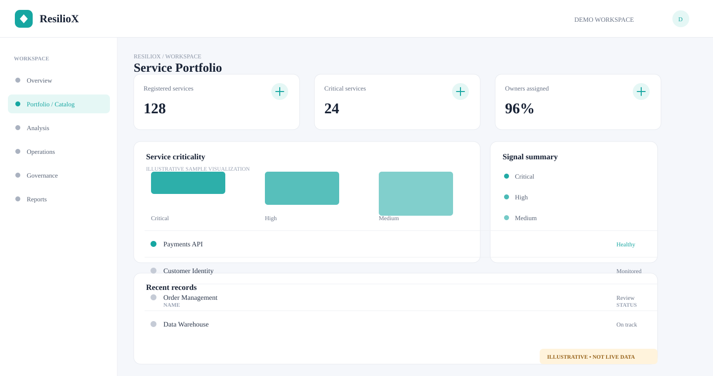

Business service portfolio — searchable service inventory and criticality context.

### 3. Business impact analysis

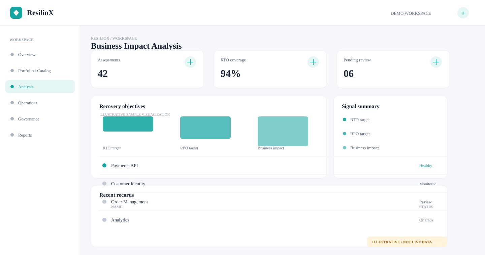

Business impact analysis — impact horizons and recovery objectives.

### 4. Dependency intelligence

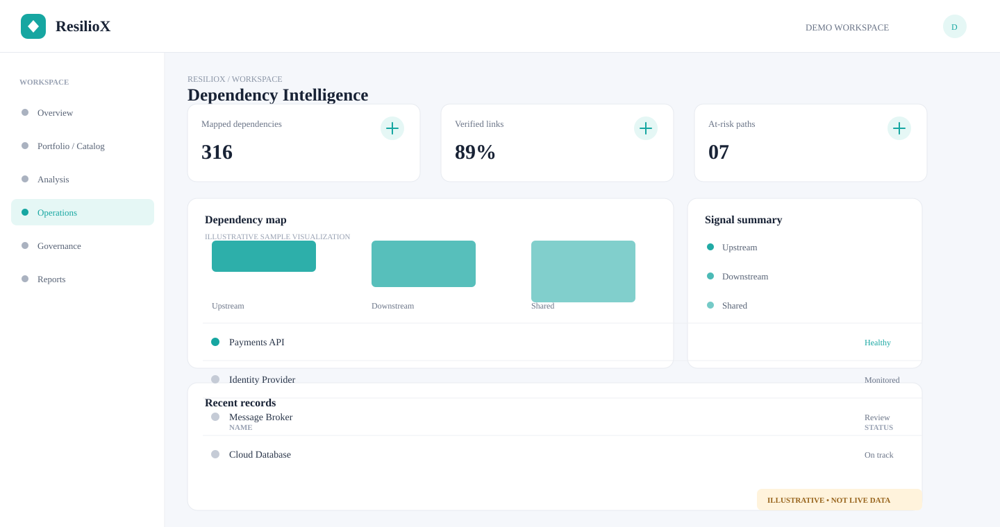

Dependency intelligence — tenant-scoped relationships and verification status.

### 5. Dependency workflow

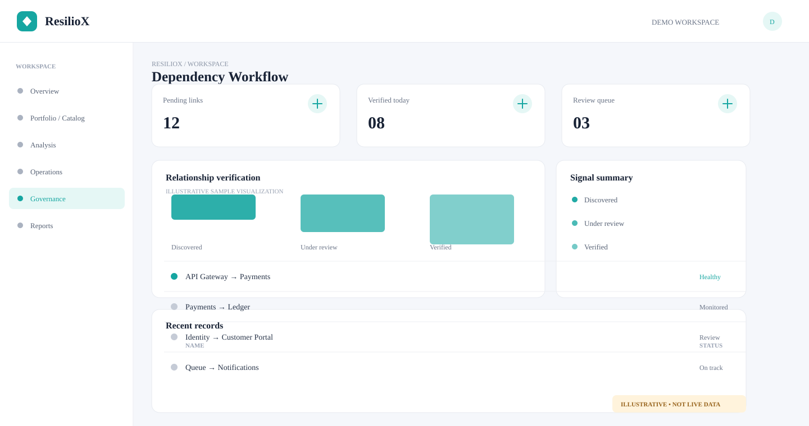

Dependency workflow — relationship capture and verification.

### 6. Operational risk register

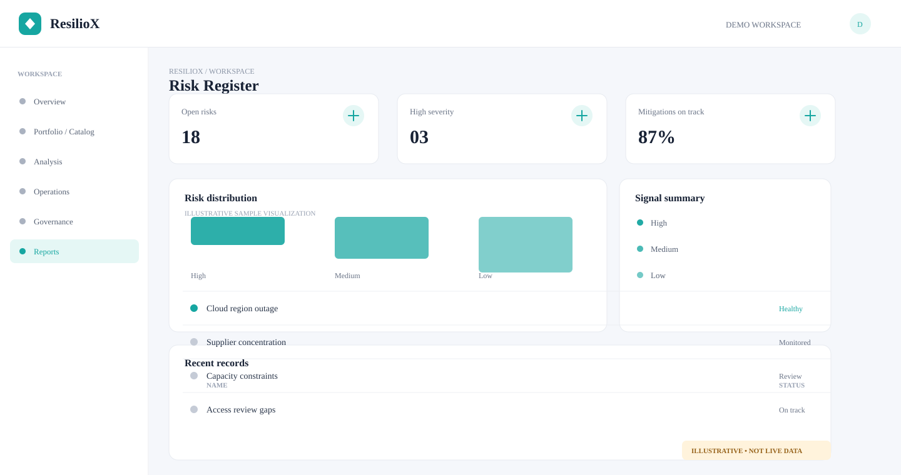

Operational risk register — inherent and residual exposure.

### 7. Incident command and response

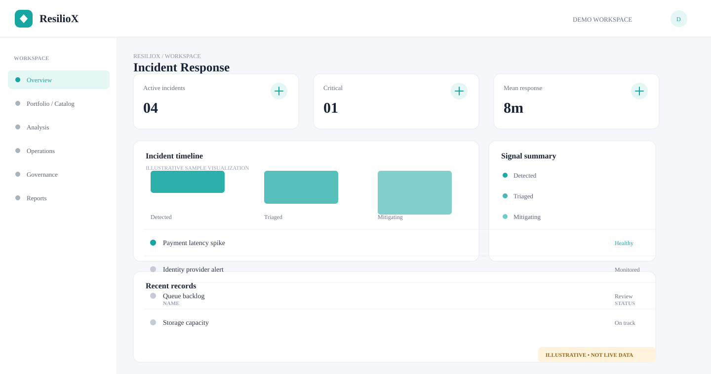

Incident command and response — severity, ownership and response timeline.

### 8. Control assurance

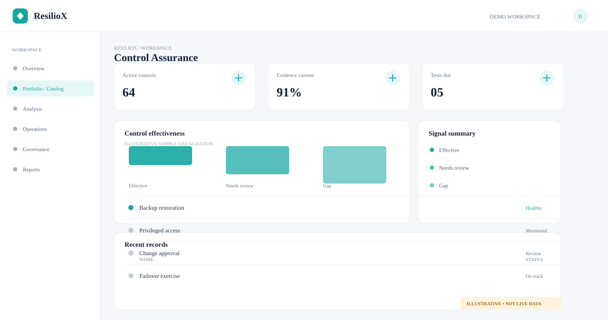

Control assurance — control library and evidence-backed testing.

### 9. Continuity workspace


Continuity workspace — plans, exercises and remediation posture.

### 10. Continuity plan builder

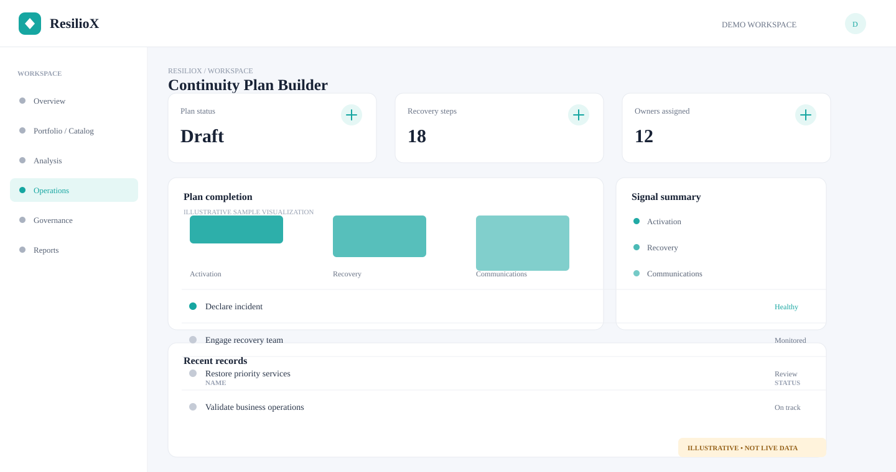

Continuity plan builder — activation, recovery and communications.

### 11. Exercise management

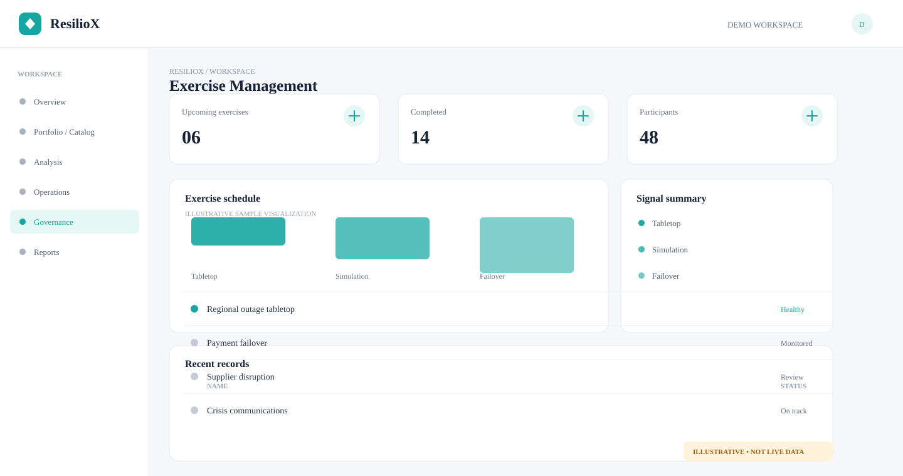

Exercise management — approved-plan scheduling and scenario objectives.

### 12. Remediation tracker

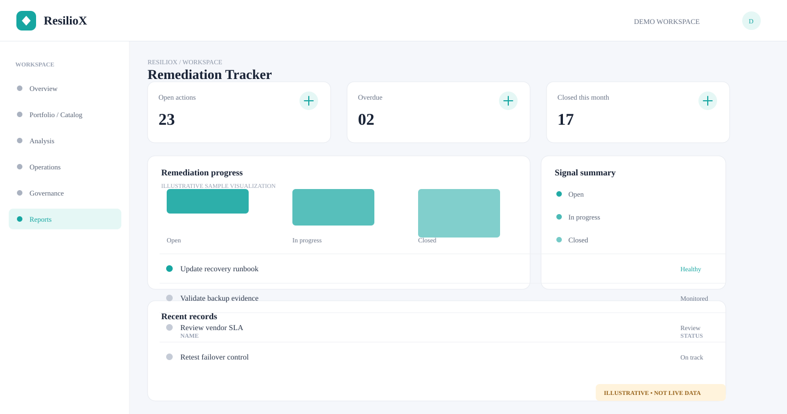

Remediation tracker — findings, owners, due dates and action status.

## Enterprise relevance and framework alignment

ResilioX is designed around operational-resilience workflows that are increasingly important to regulated and digitally dependent organizations. The product direction is informed by:

| Reference | Relevant product workflows | Product boundary |
| --- | --- | --- |
| **DORA (EU) 2022/2554** | ICT risk context, critical-function dependencies, incident response, continuity/recovery plans and resilience testing evidence | Workflow support does not establish DORA compliance or replace regulatory reporting controls. |
| **NIST CSF 2.0** | Govern/Identify/Protect/Detect/Respond/Recover mapping across risk, service inventory, incident and continuity workflows | Framework mapping is an aid to governance, not a certification or control attestation. |
| **NIST SP 800-61 Rev. 3** | Incident response preparation, coordinated response, recovery and post-incident improvement | Incident handling integrations and live detection feeds are not currently claimed. |
| **ISO 22301** | Business impact analysis, continuity planning, exercises, corrective actions and continual improvement | The product does not certify an organization or determine conformity. |

With the incident command foundation now delivered, the next differentiating increments are crisis communications orchestration, responder acknowledgement and escalation, service-impact correlation, recovery-plan activation from an incident, and post-incident learning with tracked corrective actions. These should build on the existing tenant-scoped incident timeline and audit trail rather than bypass them.

Primary references:
- [EU Digital Operational Resilience Act — Regulation (EU) 2022/2554](https://eur-lex.europa.eu/legal-content/EN/TXT/?uri=CELEX:32022R2554)
- [NIST Cybersecurity Framework 2.0](https://www.nist.gov/cyberframework)
- [NIST SP 800-61 Rev. 3 — Incident Response Recommendations](https://csrc.nist.gov/pubs/sp/800/61/r3/final)
- [ISO 22301 — Business continuity management systems](https://www.iso.org/standard/75106.html)

## Architecture

**Architecture style:** modular monolith, with one Express API and PostgreSQL system of record.

```text
Browser (React)
    │ HTTPS / JSON
    ▼
Express API ── authentication / tenant context / RBAC
    │
    ├── Command center
    ├── Business impact analysis
    ├── Dependency intelligence
    ├── Operational risk & controls
    └── Business continuity
    │
    ▼
Prisma ORM ── PostgreSQL
    │
    └── Audit events and tenant-owned records
```

Key design decisions:

1. PostgreSQL is the transactional system of record.
2. Prisma schema and versioned SQL migrations define persistence.
3. Domain routes validate requests at the API boundary with Zod.
4. Mutating workflows use database transactions for record changes and audit events.
5. Tenant scope comes from verified authentication context—not a client-supplied organization ID.
6. Polymorphic dependency and risk references are checked against the active tenant in application logic.
7. The modular monolith is preferred until measured scaling or team ownership justifies service extraction.

See [Architecture Overview](docs/architecture.md), [API Guidelines](docs/api-guidelines.md) and [Security & Privacy](docs/security-and-privacy.md).

## Technology stack

| Layer | Technology |
| --- | --- |
| Web | React 19, TypeScript, Vite |
| UI | Responsive CSS, Lucide React, Recharts |
| API | Node.js 22+, Express 5, TypeScript |
| Validation | Zod |
| Data | PostgreSQL 17, Prisma 6 |
| Authentication | Argon2id password hashing, JWT access tokens, rotating opaque refresh sessions |
| Local services | Docker Compose, PostgreSQL, Redis service for future asynchronous workloads |
| Tests | Vitest, Supertest; Playwright screenshot capture tooling |
| CI | GitHub Actions |
| Runtime architecture | Modular monolith |

## Security and enterprise controls

- Password hashes use Argon2id; plaintext passwords are never stored.
- Access tokens are short-lived; refresh tokens are opaque, hashed at rest and rotated.
- Refresh sessions use secure cookie settings appropriate to the configured deployment.
- Authentication middleware resolves the active tenant membership and role.
- Write routes enforce server-side permission checks.
- Tenant-owned reads and mutations include organization scope.
- High-impact changes emit audit events with actor, action, target and metadata.
- Request IDs, structured logs, Helmet and explicit CORS configuration are part of the API foundation.
- Input validation is performed server-side; UI validation is only a usability aid.
- Secrets belong in environment variables and must never be committed.
- Demo seed data is disabled by default and refuses to run in production.

Security is continuously improved; this repository should not be described as independently certified or production-hardened until the dedicated security milestone and review are complete. See [Security & Privacy](docs/security-and-privacy.md).

## Domain model and business rules

### Business impact analysis

- Assessments are versioned by organization and business process.
- Impact snapshots cover financial, operational, regulatory and reputational dimensions across defined time horizons.
- RTO must not exceed MTPD; RPO may be zero.
- Criticality is derived from the documented impact scoring model.
- Draft assessments are submitted for review and approved by authorized workspace roles.

### Dependency intelligence

- Edges connect supported business service, process, application, technology asset and supplier nodes.
- Tenant ownership of both endpoints is validated.
- Self-links, duplicate typed edges and directed cycles are rejected.
- New relationships begin as proposed; only verified edges are traversed in the graph explorer.
- Traversal is deterministic and bounded to protect API resources.

### Risk and controls

- Inherent score = likelihood × impact, each on a 1–5 scale.
- Residual score = ceiling(inherent score × (1 − average tested-control effectiveness / 100)).
- Risk bands: 1–4 low, 5–9 moderate, 10–16 high, 17–25 critical.
- Only controls in TESTED state can contribute non-zero effectiveness.
- A test requires an evidence summary; changing a tested control to a non-tested state removes its effectiveness and recalculates linked risks.
- Control effectiveness is an evidenced management assessment, not automated control execution.

### Business continuity

- Plans are versioned per tenant and business service.
- Plan content captures scope, activation criteria, recovery strategy, recovery procedures, communications and RTO/RPO targets.
- Lifecycle: DRAFT → IN_REVIEW → APPROVED → RETIRED.
- Approval and retirement are restricted to OWNER, ADMIN and RESILIENCE_MANAGER roles.
- Exercises can be tabletop, walkthrough, simulation or full-scale.
- Exercise lifecycle is PLANNED → IN_PROGRESS → COMPLETED, with cancellation supported.
- Completion requires an explicit outcome and findings summary.
- Findings can be converted into owner-assigned, severity-rated remediation actions with due dates and tracked status.

## API surface

All endpoints are under `/api/v1`. Protected endpoints require an authenticated tenant session.

| Area | Routes |
| --- | --- |
| Health | `GET /health/live`, `GET /health/ready` |
| Authentication | `POST /auth/login`, `POST /auth/refresh`, `POST /auth/logout`, `GET /auth/me` |
| Command center | `GET /command-center/overview` |
| BIA | `GET/POST /bia`, `GET /bia/processes`, `GET /bia/:id`, `POST /bia/:id/submit`, `POST /bia/:id/approve`, `POST /bia/:id/retire` |
| Dependencies | `GET /dependencies/nodes`, `GET/POST /dependencies`, `PATCH /dependencies/:id/status`, `GET /dependencies/graph` |
| Risk | `GET /risks`, `GET /risks/summary`, `POST /risks`, control and treatment lifecycle routes |
| Continuity | `GET /continuity`, `GET /continuity/summary`, `GET /continuity/services`, `POST /continuity`, plan submit/approve/retire, exercise and action routes |
| Incidents | `GET /incidents`, `GET /incidents/summary`, `POST /incidents`, lifecycle and severity PATCH routes, timeline event and response-task routes |

For request schemas and error semantics, inspect the route modules and [API Guidelines](docs/api-guidelines.md). An interactive OpenAPI explorer is a future enhancement, not currently claimed as shipped.

## Repository structure

```text
.
├── apps/
│   ├── api/
│   │   ├── prisma/
│   │   │   ├── migrations/
│   │   │   └── schema.prisma
│   │   ├── src/
│   │   │   ├── routes/
│   │   │   ├── middleware/
│   │   │   └── lib/
│   │   └── tests/
│   └── web/
│       └── src/
├── docs/
│   ├── architecture.md
│   ├── development-setup.md
│   ├── roadmap.md
│   ├── milestone-*.md
│   └── screenshots/
├── scripts/
│   └── capture-showcase.mjs
├── .github/workflows/ci.yml
├── docker-compose.yml
├── .env.example
└── README.md
```

## Run locally

### Prerequisites

- Node.js 22 or newer
- npm 10 or newer
- Docker Engine / Docker Desktop with Compose

### Setup

```bash
git clone https://github.com/matiur25580/ResilioX-Enterprise-Operational-Resilience-Platform.git
cd ResilioX-Enterprise-Operational-Resilience-Platform
cp .env.example .env
```

Set a unique `AUTH_TOKEN_SECRET` of at least 32 characters in `.env`, then:

```bash
docker compose up -d
npm install
npm run db:generate
npm run db:deploy
npm run dev:api
```

In a second terminal:

```bash
npm run dev:web
```

Default local URLs:

- Web: http://localhost:5173
- API: http://localhost:4000
- API base: http://localhost:4000/api/v1

Set `CORS_ORIGIN=http://localhost:5173`. If the web app needs a different API address, set `VITE_API_BASE_URL` in `apps/web/.env.local`.

See [Local Development](docs/development-setup.md) for troubleshooting and environment details.

## Demo workspace and illustrative gallery

The demo seed is fictional and disabled by default. To create a local showcase tenant:

1. Set `DEMO_SEED_ENABLED=true` in the root `.env`.
2. Set `DEMO_ADMIN_PASSWORD` to a unique password of at least 16 characters.
3. Optionally set `DEMO_ADMIN_EMAIL` and `DEMO_ORGANIZATION_SLUG`.
4. Run `npm run db:seed`.
5. Start the API and web application and sign in once to confirm the tenant works.

The repository's `docs/screenshots/` directory contains twelve illustrative SVG UI concepts. They are fictional visual examples, not browser captures, deployed screens or live telemetry. Each panel is labeled **ILLUSTRATIVE • NOT LIVE DATA**. No screenshot-capture command is required to view this gallery. The demo seed remains disabled by default and must only be used with local fictional data; never use production credentials or customer data for portfolio visuals.\n\n## Quality engineering

Run the core checks before opening or updating a pull request:

```bash
npm run db:generate
npm run typecheck
npm test
npm run build
```

The GitHub Actions workflow validates Prisma, generates the client, applies migrations against PostgreSQL, type-checks, runs tests and builds the workspaces.

A feature is not complete solely because it compiles. Acceptance includes:
- tenant authorization and resource ownership checks;
- schema validation and migration coverage;
- state-transition and scoring tests;
- auditable mutations;
- responsive loading, empty and error states;
- documentation that matches actual behavior.

## Roadmap

| Milestone | Scope | Status |
| --- | --- | --- |
| 01 | Product definition and repository foundation | Completed |
| 02 | Backend, PostgreSQL and API foundation | Completed; dependency advisory tracked |
| 03 | Identity, sessions, tenancy and RBAC | Merged to `main` (PR #1) |
| 04 | Design system and command center | Merged to `main` (PR #7) |
| 05 | Business impact analysis | Merged to `main` (PR #8) |
| 06 | Service and dependency intelligence | Merged to `main` (PR #9); CI passed |
| 07 | Operational risk and controls | Merged to `main` (PR #10); CI passed |
| 08 | Business continuity management | Merged to `main` (PR #11); CI passed |
| 09 | Incident and crisis management | Merged to `main` (PR #12); API quality gates passed |
| 10 | Disaster recovery orchestration | Planned |
| 11 | Third-party resilience | Planned |
| 12 | Scenario simulation | Planned |
| 13 | Governance, evidence and audit | Planned |
| 14 | Analytics and executive reporting | Planned |
| 15 | Notifications and real-time collaboration | Planned |
| 16 | Security review and test hardening | Planned |
| 17 | Performance, reliability and production hardening | Planned |
| 18 | Documentation, demo and release readiness | Planned |

See [the detailed roadmap](docs/roadmap.md), the [Milestone 09 incident-management specification](docs/milestone-09.md) and the [Milestone 11 third-party resilience specification](docs/milestone-11.md).

## Known boundaries

- The application is a resilience planning and coordination system, not a SIEM, NMS or real-time outage detector.
- The current incident module provides core declaration, severity, lifecycle, timeline and task coordination. Live paging integrations, responder-roster acknowledgements, automated service-impact correlation and crisis communications orchestration remain future enhancements.
- Supplier register, contract recovery commitments and evidence-backed supplier assessment are implemented in the Milestone 11 branch; disaster recovery execution and scenario simulation remain separate milestones.
- Control effectiveness is a human-assessed value supported by evidence, not proof of automated control operation.
- Exercise records are entered by authorized users; no external exercise platform is connected.
- No regulatory certification, independent penetration test or production SLA is claimed.
- A dependency graph is bounded and tenant-scoped; it is not a substitute for a live infrastructure discovery tool.

## Contributing

See [CONTRIBUTING.md](CONTRIBUTING.md). Keep changes scoped to a milestone, add migration and tests for domain changes, preserve tenant boundaries, document scoring assumptions and avoid committing secrets or customer information.

## License

No license has been selected. Until a license is added, standard copyright applies; reuse permissions are not granted by default.
