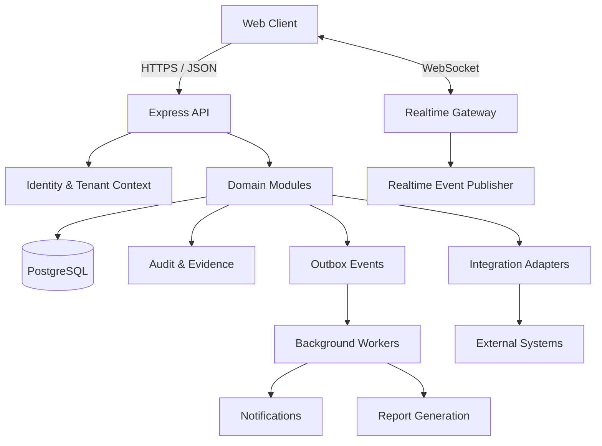

# Architecture Overview

## 1. Product boundary

ContinuityGrid manages organizational operational resilience information and workflows. It is a system of record and coordination layer for resilience planning, risk, disruption response and recovery readiness.

It is not, by default:
- a network monitoring or SIEM product;
- a replacement for cloud-provider control planes;
- a real-time disaster detection service;
- an automated authority to execute production recovery actions.

External telemetry and orchestration require explicitly configured adapters, permissions, and operational safeguards.

## 2. Architecture style

Start with a **modular monolith** using a single deployable API and a shared PostgreSQL database. Each domain owns its application services, validation, persistence interfaces and events. Cross-domain access should use exported application interfaces rather than reaching into another module's internals.

Extract a service only when a concrete operational need exists (independent scaling, isolation, team ownership, or deployment cadence).

## 3. Logical system

The diagram is a target logical design. Implementation may consolidate runtime components while preserving boundaries.

## 4. Domain modules

| Module | Owns | Important relationships |
| --- | --- | --- |
| Identity & tenancy | Users, organizations, memberships, roles, sessions | All tenant-owned records |
| Organization | Business units, locations, teams, ownership | Services, suppliers, incidents |
| Service catalog | Business services, processes, service owners | Applications, assets, suppliers |
| Dependency graph | Typed nodes and directed relationships | Impact analysis and scenario engine |
| BIA | Impact assessments, time horizons, recovery objectives | Services and processes |
| Risk | Risks, controls, assessments, treatments | Services, assets, suppliers |
| Continuity | Strategies, plans, exercises, approvals | BIA, risks, services |
| Incident | Incidents, updates, tasks, decisions, response teams | Services, plans, dependencies |
| Disaster recovery | Recovery plans, steps, runbooks, test results | Applications, infrastructure, RTO/RPO |
| Third-party | Suppliers, services, assessments, findings | Business services and risks |
| Simulation | Scenarios, assumptions, impact results, runs | Dependency graph, BIA, recovery plans |
| Governance | Evidence, audit events, policies, approvals | All controlled workflows |
| Analytics | Read models, snapshots and report definitions | Domain-owned data projections |

## 5. Data ownership and tenancy

Every tenant-owned entity must carry an organization/tenant identifier. The authenticated request context resolves the active tenant from a verified membership; clients must never be trusted to choose arbitrary tenant scope.

Repository methods require tenant scope explicitly. Update and delete operations must include both record identity and tenant scope. Cross-tenant access tests are mandatory.

Global reference data (for example, static severity definitions) must be intentionally separated from tenant-owned records.

## 6. Dependency graph

Represent dependencies as typed, directed edges between known entities. Each relationship records:
- source and target entity;
- relationship type and direction;
- criticality or influence where applicable;
- effective dates and lifecycle status;
- owner and evidence/source;
- confidence and last verification date.

Prevent invalid self-links and unsupported entity combinations. Define cycle handling deliberately: cycles may exist in real dependency graphs, so traversal must detect visited nodes and avoid infinite recursion. Impact propagation should report its assumptions and path.

## 7. Reliability patterns

- Database transactions for multi-record business operations.
- Idempotency keys for retryable commands where duplicate execution is harmful.
- Transactional outbox before publishing durable domain events.
- Bounded retries with backoff for background work.
- Explicit job status, failure reason and retry policy.
- Timeouts and circuit-breaking at external adapter boundaries.
- Structured logs with request and correlation identifiers.
- Health and readiness endpoints with dependency checks.

## 8. API conventions

- Versioned base path: `/api/v1`.
- Resource-oriented routes and consistent HTTP semantics.
- Zod validation at request boundaries.
- Stable error envelope with machine-readable code and request ID.
- Pagination for collections; deterministic ordering.
- UTC timestamps in ISO 8601.
- OpenAPI generated from or kept in sync with runtime contracts.
- Authorization checks in application services, not only route middleware.

See [API Guidelines](api-guidelines.md).

## 9. Security and privacy

See [Security & Privacy](security-and-privacy.md). Security is a cross-cutting requirement, not a later UI feature.

## 10. Architecture decision records

### ADR-001: Modular monolith first

**Decision:** Start as a modular monolith.

**Reason:** The product is early, domains are evolving, and transactional workflows cross domain boundaries. A modular monolith lowers operational complexity while preserving extraction options.

**Trade-off:** Requires disciplined module boundaries and dependency rules.

### ADR-002: PostgreSQL as the system of record

**Decision:** Use PostgreSQL for core transactional data and relational integrity.

**Reason:** Tenant-scoped workflows, auditability, typed relationships and reporting benefit from relational constraints and transactions.

**Trade-off:** Graph traversal is implemented with relational queries initially; introduce a dedicated graph store only if evidence warrants it.

### ADR-003: Simulations are not live telemetry

**Decision:** Clearly label generated/sample scenario outputs as simulations.

**Reason:** Users must understand data provenance and not mistake illustrative data for operational monitoring.
